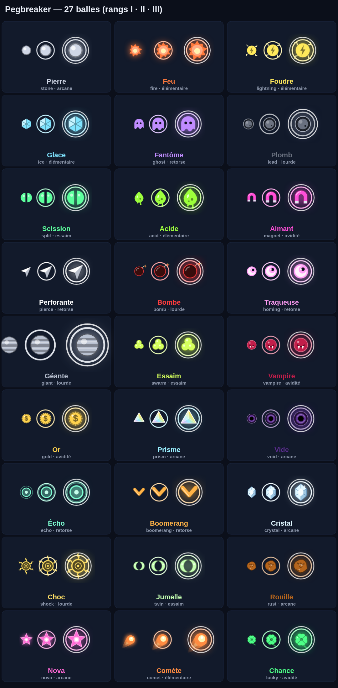

# PEGBREAKER — Les 27 balles (2026-10-17)

Chaque balle a **une** mécanique lisible en une phrase, un effet amplifié par le rang (II, III), et une place dans le build (synergie avec le combo, la fusion, les contrats ou une relique). Les 7 d'origine restent ; 20 nouvelles.

Rang : sauf mention, rang II = effet ×1,5 (ou +1 selon la nature), rang III = ×2 (ou +2). Les dégâts suivent toujours `tierDamageMultiplier`.

## Familles (pour le son et le visuel)
`elemental` (feu, foudre, glace, acide, comète), `heavy` (plomb, géante, bombe, choc), `tricky` (fantôme, perforante, quantique, écho, boomerang, traqueuse), `swarm` (scission, essaim, jumelle), `greed` (or, chance, aimant, vampire), `arcane` (prisme, vide, cristal, nova, rouille, pierre).

## Les 20 nouvelles

| id | Nom | Effet (rang I) | Rang II / III | Famille | Déblocage |
|---|---|---|---|---|---|
| acid | Acide | Le bloc touché perd 6 % de ses PV max (60 PV au plus) au début de chacun des 3 tirs suivants (cumul max 3 charges). | 9 % (max 90) / 12 % (max 120) | elemental | Puits 45 ◆ (après Feu) |
| magnet | Aimant | Ramasse les drops à moins de 1,2 u de sa trajectoire. | 1,8 / 2,5 u | greed | Puits 40 ◆ |
| pierce | Perforante | Traverse le premier bloc touché de chaque tir (dégâts ×1,5), puis rebondit normalement. Dégâts de base 6 (au lieu de 10). | 2 / 3 blocs traversés | tricky | Puits 60 ◆ |
| bomb | Bombe | Explose en touchant le sol : rayon 1,4 u, dégâts ×3 de sa base. | rayon 1,8 / 2,2 | heavy | Puits 90 ◆ |
| homing | Traqueuse | Après chaque rebond, dévie de 8° au plus (angle minimal compris) vers le bloc le plus proche. | 14° / 20° | tricky | Puits 190 ◆ (après Perforante) |
| giant | Géante | Rayon ×1,8, dégâts ×2, vitesse ×0,85, combo +0 par rebond de mur. | rayon ×2,1 / ×2,4 | heavy | Puits 240 ◆ (après Bombe) |
| swarm | Essaim | À chaque impact, 25 % de chance de libérer une mini-balle (dégâts ×0,3, rayon ×0,6, 6 max par balle d'essaim et par tir). | 35 % / 50 % | swarm | Puits 150 ◆ (après Jumelle) |
| vampire | Vampire | Chaque bloc qu'elle détruit rend 1 PV (1 fois par tir ; un soin à PV pleins n'est pas compté). | 2 / 3 fois par tir | greed | Puits 320 ◆ |
| gold | Or | Les blocs qu'elle détruit lâchent toujours une pièce (valeur ×1,5), en plus de la balle garantie si elle tombe ; dégâts ×0,85. | ×2 / ×3 | greed | Puits 50 ◆ (après Aimant) |
| prism | Prisme | À chaque rebond de mur latéral, un rayon horizontal inflige 40 % de ses dégâts (150 au plus) à chaque bloc de sa rangée. | 55 % (max 250) / 70 % (max 350) | arcane | Puits 350 ◆ (après Foudre) |
| void | Vide | Ignore l'armure et ajoute 6 % des PV max du bloc (60 au plus) à chaque impact. | 9 % (max 90) / 12 % (max 120) | arcane | Puits 400 ◆ (après Rouille) |
| echo | Écho | Quand elle touche le sol, une copie traversante (50 % dégâts) repart vers le haut depuis ce point, une fois. | 70 % / 100 % | tricky | Puits 240 ◆ (après Boomerang) |
| boomerang | Boomerang | Après 0,9 s de vol, fait demi-tour vers le point de lancement en traversant les blocs (frappés au passage) ; se pose à l'arrivée. | 2 / 3 allers-retours | tricky | Puits 190 ◆ |
| crystal | Cristal | +30 % de dégâts par rebond (en plus du combo) mais éclate après 8 rebonds (éclats : 4 mini-balles ×0,4 en éventail de ±40°). | 10 / 12 rebonds | arcane | Puits 100 ◆ |
| shock | Choc | Le bloc touché recule d'une rangée vers le haut si la case est libre (1 fois par bloc par tir ; jamais un boss). | 2 / 3 fois | heavy | Puits 170 ◆ |
| twin | Jumelle | Tirée en deux balles à angles miroirs (±8°), 70 % de dégâts chacune. | 3 / 4 balles | swarm | Puits 80 ◆ (après Scission) |
| rust | Rouille | Au premier contact, le bloc perd 15 % de PV max (120 au plus) définitivement et son armure. | 22 % (max 180) / 30 % (max 240) | arcane | Puits 55 ◆ |
| nova | Nova | À chaque palier de combo (3/8/16), explose : rayon 1,2 u, dégâts = combo × 8 (600 au plus). | ×10 (max 900) / ×14 (max 1 200) | arcane | Succès « Flipper » (combo 15) |
| comet | Comète | Vitesse ×1,4 ; chaque rebond de plafond donne +3 combo. | +4 / +6 | elemental | Succès « Premier boss » (vaincre un boss) |
| lucky | Chance | 20 % de critique ×3 par impact ; les drops qu'elle ramasse valent double. | 30 % / 40 % | greed | Succès « Cinq mille » (5 000 dégâts en un tir) |

Déblocages par succès : le succès débloque l'élément sans fragment (`unlockElement:` via achievement `unlocks`).

## Règles communes
- Toutes apparaissent dans les drops, les offres et la boutique **seulement si débloquées** (`unlockedElements`). Poids de tirage dans `balls.json` (les fortes ont un poids plus faible).
- Fusion : identique pour toutes (même élément, même rang).
- Contrats `killWithElement` : étendus aux nouvelles familles (un contrat par famille, tiré seulement si la volée contient un élément de la famille).
- Reliques : `pyromane`, `paratonnerre`, `permafrost`, `spectre`, `enclume`, `mitose` s'appliquent aussi aux balles proches (comète = feu pour pyromane ? non : chaque relique garde son élément exact ; pas de synergie implicite).
- Plafond de performance : mini-balles (essaim, cristal, jumelle, écho) comptent dans la limite de 30 balles vivantes par tir.
